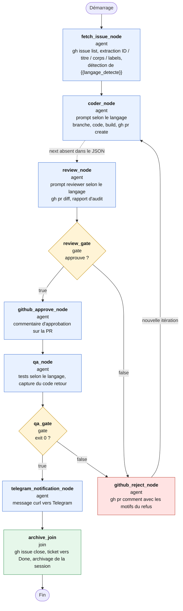
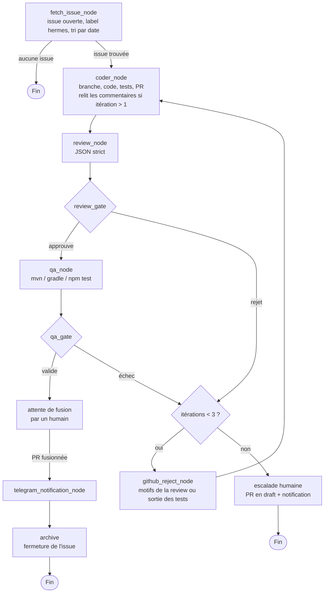

# Workflow `boucle_github_multi_langages` (`workflow-dev.json`)

## 1. Vue d'ensemble

Ce workflow orchestre une boucle de développement automatisée autour d'une issue GitHub :

1. un agent récupère une issue ouverte et détecte le langage du projet ;
2. un agent **Coder** écrit le correctif et ouvre une Pull Request ;
3. un agent **Reviewer** relit le diff, puis une **Gate** décide d'approuver ou de rejeter ;
4. en cas d'approbation, un agent **QA** lance les tests, validés par une seconde Gate ;
5. si tout est vert, une notification Telegram est envoyée et l'issue est archivée.

Tout rejet (review ou QA) renvoie la PR au Coder pour une nouvelle itération.

Les prompts système des agents Coder et Reviewer sont chargés selon la variable `{{langage_detecte}}` :

| Langage | Prompt Coder | Prompt Reviewer |
|---|---|---|
| Java | `java-agent-coder-system-prompt.md` | `java-agent-reviewer-system-prompt.md` |
| TypeScript | `typescript-agent-coder-system-prompt.md` | `typescript-agent-reviewer-system-prompt.md` |
| Autre | persona adapté dynamiquement (pas de prompt dédié) | persona adapté dynamiquement |

## 2. Diagramme

> Le diagramme est au format [Mermaid](https://mermaid.js.org/). Il s'affiche directement sur GitHub, dans VS Code (extension Markdown Preview Mermaid) et dans la plupart des visionneuses Markdown.

Légende : bleu = agent, jaune = gate (décision), vert = join (fin de flux), rouge = nœud de rejet qui alimente la boucle de correction. La flèche en pointillé de `coder_node` vers `review_node` indique une transition **implicite** : elle n'est pas déclarée dans le JSON (voir section 5).

## 3. Description des nœuds

| Nœud | Type | Rôle | Sortie vers |
|---|---|---|---|
| `fetch_issue_node` | agent | Exécute `gh issue list --limit 1`, extrait l'ID, le titre, le corps et les labels, puis définit `{{langage_detecte}}` d'après les labels (sinon d'après le corps de l'issue). | `coder_node` |
| `coder_node` | agent | Charge le prompt Coder du langage, crée la branche `hermes-fix-{{issue_id}}`, modifie le code via `fs`, compile localement et ouvre la PR avec `gh pr create`. | *(aucune transition déclarée)* |
| `review_node` | agent | Charge le prompt Reviewer du langage, analyse le diff via `gh pr diff` et rédige un rapport d'audit technique. | `review_gate` |
| `review_gate` | gate | Décide d'après le rapport. Renvoie un JSON avec `approuve: true/false`. | `true` → `github_approve_node`, `false` → `github_reject_node` |
| `github_reject_node` | agent | Poste les motifs du refus sur la PR via `gh pr comment`, en soulignant les manquements aux conventions du langage. | `coder_node` |
| `github_approve_node` | agent | Poste sur GitHub un commentaire d'approbation détaillant la conformité du code. | `qa_node` |
| `qa_node` | agent | Détermine l'environnement du langage, lance les tests via `bash` (`pytest`, `npm test`, `cargo test`…) et capture le code retour `$?`. | `qa_gate` |
| `qa_gate` | gate | Analyse le rapport d'exécution : `valide: true` si le code retour vaut 0, sinon `false`. | `true` → `telegram_notification_node`, `false` → `github_reject_node` |
| `telegram_notification_node` | agent | Formate un message `curl` pour notifier Telegram que l'issue est résolue, validée et fusionnée. | `archive_join` |
| `archive_join` | join | Ferme l'issue (`gh issue close`), déplace le ticket vers « Done » et archive la session. | fin (`next: null`) |

## 4. Variables et boucles

- **`{{langage_detecte}}`** : définie par `fetch_issue_node`, lue par `coder_node`, `review_node`, `github_reject_node`, `github_approve_node`, `qa_node` et `telegram_notification_node`.
- **`{{issue_id}}`** : extraite par `fetch_issue_node`, utilisée pour le nom de branche, le message Telegram et la fermeture de l'issue.
- **Boucle de correction** : `coder_node → review_node → review_gate → github_reject_node → coder_node`.
- **Boucle QA** : `qa_gate → github_reject_node → coder_node`, puis une nouvelle revue complète.
- Le workflow traite **une seule issue** par exécution. Malgré le nom « boucle », aucune transition ne retourne à `fetch_issue_node`.

## 5. Points d'attention constatés

Ces points viennent de la lecture du JSON. Je n'ai pas exécuté le workflow.

### Bloquants

1. **`coder_node` n'a pas de `next`.** Si le moteur ne déduit pas la transition, le flux s'arrête après le Coder et la revue n'est jamais lancée. Ajouter `"next": "review_node"`.
2. **Aucune limite d'itérations.** Un rejet renvoie toujours au Coder. Un Reviewer trop strict, ou une QA qui échoue pour une raison d'environnement, crée une boucle infinie. Ajouter un compteur (par exemple 3 itérations), puis une escalade vers un humain.
3. **La PR n'est jamais fusionnée, mais le flux l'affirme.** Le message Telegram dit « fusionnée avec succès » et `archive_join` ferme l'issue, alors que le Coder et le Reviewer n'ont pas le droit de fusionner (d'après leurs prompts) et qu'aucun nœud ne le fait. Soit on ajoute une étape de fusion ou d'attente d'un humain, soit on corrige le message et on ne ferme l'issue qu'après la fusion.

### Importants

4. **`gh issue list --limit 1` ne renvoie pas « la plus ancienne ».** Par défaut la liste est triée de la plus récente à la plus ancienne. De plus rien ne filtre l'état (`--state open`), un label dédié (par exemple `hermes`), ni les issues déjà traitées. Utiliser par exemple `--search "sort:created-asc"` avec un label.
5. **Le cas « aucune issue » n'est pas géré.** Si la liste est vide, le flux devrait se terminer proprement.
6. **Le `goal` de `coder_node` est écrit pour Java** (« patterns Java modernes »), même quand le langage est TypeScript. Il doit être générique, ou déléguer entièrement au prompt système.
7. **Nom de branche incohérent.** Le workflow dit `hermes-fix-{{issue_id}}`, les prompts du Coder disent `hermes-fix-issue-<issue_id>`. Aligner les deux.
8. **Le `goal` de `review_node` contredit le prompt Reviewer.** Il demande un « rapport d'audit technique argumenté » en texte et mentionne Python et Rust, alors que le prompt impose une réponse JSON stricte pour la Gate. Le `goal` doit se limiter à « applique le prompt système et renvoie uniquement le JSON ».
9. **Le retour au Coder ne transmet pas le contexte.** `github_reject_node` poste un commentaire, mais `coder_node` n'est pas informé qu'il doit relire les commentaires de la PR, réutiliser la branche existante et ne pas ouvrir une seconde PR. À préciser dans le `goal`.
10. **Un échec QA passe par `github_reject_node`**, dont le `goal` parle des « manquements aux conventions du langage » : il ne décrit pas un échec de tests. Il faut lui transmettre la sortie de la QA, ou créer un nœud de rejet dédié.
11. **`qa_node` ne prévoit pas Java** (ni Maven ni Gradle), alors que Java est un langage principal. Ajouter `mvn test` / `./gradlew test`. Le Reviewer ne lance pas les tests : cette étape est la seule exécution réelle des tests.

### À surveiller

12. **Injection de prompt.** `fetch_issue_node` déduit le langage du corps de l'issue, et le contenu de l'issue est ensuite lu par le Coder. Le corps d'une issue est une entrée non fiable : il ne doit pas pouvoir modifier le workflow (langage, prompts, commandes).
13. **Détection du langage fragile.** Les comparaisons `== 'Java'` et `== 'Typescript'` sont sensibles à la casse et à la forme du label (`java`, `typescript`, `ts`). Prévoir une normalisation et un comportement explicite pour un langage inconnu ou une issue multi-langages.
14. **Secrets Telegram.** Le jeton du bot et l'identifiant du chat ne doivent pas apparaître dans le JSON ni dans les logs : les passer par des variables d'environnement ou un coffre de secrets. Le `\'` dans la chaîne du message est aussi à vérifier selon le moteur.
15. **`archive_join` n'a qu'une entrée.** Un `join` sert normalement à fusionner plusieurs branches. Ici c'est un simple nœud final, et « déplacer le ticket vers Done » n'a pas d'outil ou de commande précisé.
16. **Les prompts Python et Rust sont cités mais n'existent pas.** Les `goal` de `review_node` et `qa_node` les mentionnent. Soit on crée ces prompts, soit on retire ces références pour ne pas induire l'agent en erreur.
17. **Fichiers de prompts non versionnés.** Le dossier `hermes-workflow/` n'est pas encore suivi par git.

## 6. Version corrigée du flux (proposition)

Les changements par rapport au flux actuel : arrêt propre sans issue, compteur d'itérations avec escalade, QA lancée sur le code approuvé avec les bons outils par langage, attente d'une fusion réelle avant la notification et la fermeture de l'issue.
