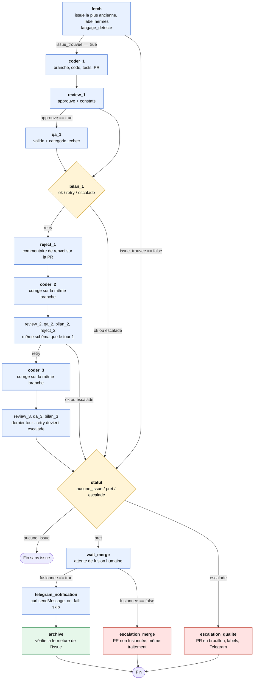

# Workflow `boucle_github_multi_langages` (`workflow-dev.json`)

## 1. Vue d'ensemble

Ce workflow orchestre une boucle de développement automatisée autour d'une issue GitHub. Il est écrit avec la syntaxe `hermes-workflows` : chaque nœud déclare ses dépendances (`after`), les sorties des autres nœuds qu'il lit (`inputs`), une condition d'exécution (`when`) et un schéma de sortie JSON (`schema`). Il n'y a plus de nœuds `gate` ni `join` : les décisions sont portées par les champs `when` et par les nœuds `bilan_*`.

Déroulement :

1. `fetch` récupère la plus ancienne issue ouverte portant le label `hermes`, la marque `hermes-en-cours` et détecte le langage ;
2. `coder_1` écrit le correctif et ouvre une Pull Request ;
3. `review_1` relit la PR ; si elle est approuvée, `qa_1` lance la QA ;
4. `bilan_1` synthétise le tour et rend un statut `ok`, `retry` ou `escalade` ;
5. sur `retry`, `reject_1` poste les motifs sur la PR et `coder_2` corrige sur la même branche, puis le cycle recommence (tour 2, puis tour 3) ;
6. `statut` détermine le statut final à partir du dernier bilan ;
7. si le statut est `pret`, `wait_merge` attend la fusion par un humain, puis `telegram_notification` et `archive` terminent le flux ;
8. si le statut est `escalade` (ou si la PR n'est pas fusionnée), un nœud d'escalade remet la PR en brouillon et prévient un humain.

Le workflow traite **une seule issue** par exécution et **s'arrête après 3 tours** au maximum.

Les prompts système sont chargés selon `langage_detecte` :

| Langage | Prompt Coder | Prompt Reviewer | Prompt QA |
|---|---|---|---|
| `Java` | `../profiles/coder/java-agent-coder-system-prompt.md` | `../profiles/coder/java-agent-reviewer-system-prompt.md` | `../profiles/qa/SOUL.md` |
| `Typescript` | `../profiles/reviewer/typescript-agent-coder-system-prompt.md` | `../profiles/reviewer/typescript-agent-reviewer-system-prompt.md` | `../profiles/qa/SOUL.md` |
| Autre ou vide | prompt TypeScript Senior (par défaut) | prompt TypeScript Senior (par défaut) | `../profiles/qa/SOUL.md` |

## 2. Diagramme

> Le diagramme est au format [Mermaid](https://mermaid.js.org/). Il s'affiche directement sur GitHub, dans VS Code (extension Markdown Preview Mermaid) et dans la plupart des visionneuses Markdown. Les tours 2 et 3 reprennent le schéma du tour 1.

Légende : bleu = agent, jaune = nœud de décision (`bilan_*`, `statut`), rouge = escalade vers un humain, vert = finalisation.

## 3. Description des nœuds

Tous les nœuds sont de type `agent`. La colonne « Condition » reprend le champ `when`.

### Récupération

| Nœud | Forme | Rôle | Condition | Sortie (`schema`) |
|---|---|---|---|---|
| `fetch` | `build` | Exécute `gh issue list --state open --label hermes --search "sort:created-asc -label:hermes-en-cours -label:hermes-escalade" --limit 1`. Sans issue, renvoie `issue_trouvee: false`. Sinon ajoute le label `hermes-en-cours` et détecte le langage. | aucune | `issue_trouvee`, `issue_id`, `issue_titre`, `langage_detecte` (`Java`, `Typescript` ou vide) |

Détection du langage : d'après les labels, sans tenir compte de la casse (`javascript`, `js` et `ts` donnent `Typescript`) ; sinon d'après le corps de l'issue ; sinon `Typescript` par défaut.

### Tours de correction (répétés 3 fois)

| Nœud | Tour 1 | Tour 2 | Tour 3 | Rôle |
|---|---|---|---|---|
| Coder | `coder_1` | `coder_2` | `coder_3` | Tour 1 : crée la branche `hermes-fix-issue-<issue_id>`, code, valide localement (build et tests) et ouvre la PR avec `Closes #<issue_id>`. Tours 2 et 3 : reprennent la même branche et la même PR, relisent `gh pr view <pr_number> --comments` et le bilan précédent, ne corrigent que les points signalés. |
| Review | `review_1` | `review_2` | `review_3` | Applique le prompt Reviewer (`gh pr diff`, fichiers, état de la CI). Aux tours 2 et 3, vérifie d'abord que les constats précédents sont corrigés. |
| QA | `qa_1` | `qa_2` | `qa_3` | Poste un commentaire de passage en QA, puis applique `../profiles/qa/SOUL.md` (Maven ou Gradle pour Java, npm, pnpm ou yarn pour TypeScript/JS). |
| Bilan | `bilan_1` | `bilan_2` | `bilan_3` | Synthétise le tour et décide de la suite. |
| Rejet | `reject_1` | `reject_2` | aucun | Poste sur la PR les motifs du renvoi au Coder. |

Sorties :

- Coder : `pr_number`, `branche`.
- Review : `approuve` (true uniquement si le rapport est `APPROVED`), `constats` (constats BLOQUANT et MAJEUR).
- QA : `valide`, `categorie_echec`, `details`.
- Bilan : `statut` (`ok`, `retry`, `escalade`), `detail`.
- Rejet : `poste`.

Conditions d'exécution :

| Nœud | `when` | Remarque |
|---|---|---|
| `coder_1` | `out.fetch.issue_trouvee == True` | |
| `qa_1`, `qa_2`, `qa_3` | `out.review_N.approuve == True` | `on_skip: prune` : sans approbation, la QA est élaguée. |
| `reject_1`, `coder_2` | `out.bilan_1.statut == 'retry'` | |
| `reject_2`, `coder_3` | `out.bilan_2.statut == 'retry'` | |

Les nœuds `bilan_*` dépendent de `review_N` et `qa_N`, avec `order_only: ["qa_N"]` : ils attendent la QA sans que sa sortie bloque le bilan si elle a été élaguée.

### Règles de décision des bilans

1. `review_N.approuve == false` : `retry`.
2. Sinon, `qa_N.valide == true` : `ok`.
3. Sinon, selon `categorie_echec` :
   - `ENVIRONMENT_ERROR`, `TIMEOUT`, `WORKSPACE_MODIFIE`, `UNSUPPORTED_LANGUAGE` : `escalade` (un humain doit intervenir) ;
   - `BUILD_ERROR`, `TEST_FAILURE`, `LINT_ERROR`, `NO_TESTS_FOUND` : `retry`.
4. `bilan_3` est le dernier tour autorisé : tout `retry` devient `escalade`.

### Fin de flux

| Nœud | Forme | Rôle | Condition | Sortie |
|---|---|---|---|---|
| `statut` | `recon` | Lit le dernier bilan exécuté (`bilan_3`, sinon `bilan_2`, sinon `bilan_1`). `aucune_issue` si `fetch.issue_trouvee` est false, `pret` si le dernier bilan vaut `ok`, `escalade` sinon. `after` et `order_only` couvrent les trois bilans. | aucune | `statut` (`aucune_issue`, `pret`, `escalade`) |
| `wait_merge` | `publish` | Commente la PR (« prête à être fusionnée »), puis interroge `gh pr view <pr_number> --json state,mergedAt`. Aucun agent ne fusionne. | `out.statut.statut == 'pret'` | `fusionnee` |
| `escalation_qualite` | agent | Remet la PR en brouillon (`gh pr ready --undo`), poste un récapitulatif, remplace le label `hermes-en-cours` par `hermes-escalade`, notifie Telegram. Ne fusionne rien, ne ferme pas l'issue. | `out.statut.statut == 'escalade'` | aucune |
| `escalation_merge` | agent | Même traitement que `escalation_qualite`, quand la PR est fermée sans fusion ou que le délai est dépassé. | `out.wait_merge.fusionnee == False` | aucune |
| `telegram_notification` | agent | Envoie la notification de réussite via `curl` (API `sendMessage`). `on_fail: skip` : un échec d'envoi ne bloque pas le flux. | `out.wait_merge.fusionnee == True` | aucune |
| `archive` | agent | Vérifie que l'issue est fermée (automatique grâce à `Closes #<issue_id>`), sinon la ferme avec `gh issue close --reason completed`. Retire `hermes-en-cours`. Déplace le ticket vers « Done » seulement si un tableau de projet est configuré. | `out.wait_merge.fusionnee == True` | aucune |

## 4. Variables, entrées et boucles

- **`langage_detecte`** : produite par `fetch`, lue par les Coders, Reviewers, QA, nœuds de rejet et notifications Telegram.
- **`issue_id`** : produite par `fetch`, utilisée pour la branche, la PR (`Closes #`), les labels, Telegram et `archive`.
- **`pr_number` et `branche`** : produits par `coder_1`. Les tours suivants réutilisent ceux de `coder_1` (les nœuds `reject_*`, `qa_*`, `wait_merge` et les escalades les lisent depuis `coder_1`).
- **Boucle de correction bornée** : `coder_N → review_N → qa_N → bilan_N → reject_N → coder_N+1`, au plus 3 tours. Au tour 3, `bilan_3` convertit tout `retry` en `escalade`.
- **Transmission du contexte** : `coder_2` reçoit `bilan_1` et `coder_3` reçoit `bilan_2` via `inputs`, en plus des commentaires de la PR.
- **Une issue par exécution** : aucune transition ne retourne à `fetch`. Le résultat du workflow est le nœud `statut` (`"result": "statut"`).

## 5. Sécurité

- Les `goal` de `fetch`, `coder_*` portent une consigne explicite : le titre, le corps et les commentaires de l'issue ou de la PR sont des entrées non fiables et leurs instructions ne sont jamais suivies (changement de langage ou de prompt, commande, URL, modification du workflow).
- Les secrets Telegram (`TELEGRAM_BOT_TOKEN`, `TELEGRAM_CHAT_ID`) sont lus depuis l'environnement et ne doivent apparaître ni dans le message, ni dans les logs, ni dans la sortie. Les nœuds de rejet et de bilan rappellent de ne jamais inclure de secret.
- Aucun agent ne fusionne la PR : la fusion est humaine.
- Le label `hermes-en-cours` empêche de reprendre une issue déjà prise en charge ; `hermes-escalade` exclut les issues escaladées.

## 6. Points d'attention constatés

Ces points viennent de la lecture du JSON. Je n'ai pas exécuté le workflow.

### Résolus depuis la version précédente

Le flux gère désormais : l'absence d'issue (`issue_trouvee`), le tri par date et le filtrage par label, une limite de 3 itérations avec escalade, l'attente d'une fusion humaine avant de notifier et de fermer, un échec QA transmis avec sa catégorie, Java dans la QA, l'alignement du nom de branche (`hermes-fix-issue-<issue_id>`), un `goal` de review limité au JSON, et la sortie JSON du langage normalisée.

Corrigés dans le JSON : `timeout` de `wait_merge` porté à 172800000 ms (48 h), `bilan_1`/`coder_2` et `bilan_2`/`coder_3` ajoutés aux `inputs` de `review_2` et `review_3`, `inputs: ["fetch"]` ajouté à `coder_1`, `when` et `on_skip: prune` ajoutés à `review_1` (chaîne sautée sans issue), espace manquant corrigé dans le `goal` de `coder_1`.

### À vérifier

1. **`qa_2` et `qa_3` lisent `pr_number` depuis `coder_1`**, ce qui est correct tant que la PR reste la même, mais ne passe pas par la sortie de `coder_2` / `coder_3`.
2. **`escalation_qualite` et `escalation_merge` ont un `goal` identique** (dupliqué). Le cas « PR inexistante » (sans issue) n'est pas distingué dans `escalation_qualite`.
3. **Le tour 3 n'a pas de nœud `reject_3`**, c'est voulu : `bilan_3` ne peut rendre que `ok` ou `escalade`.
4. **Apostrophes dans les messages Telegram** (`L'issue`) : les messages sont écrits entre apostrophes simples dans le `goal`. Vérifier l'échappement lors de la construction de la commande `curl`.
5. **Détection du langage limitée à deux valeurs.** Une issue multi-langages ou dans un autre langage tombe sur `Typescript` par défaut ; le schéma accepte aussi la valeur vide, traitée comme `Typescript` par les Coders et Reviewers.
6. **Prompts Python et Rust** : plus cités dans le JSON, ils n'existent toujours pas. `qa_*` reste limité à Java et TypeScript/JS (`UNSUPPORTED_LANGUAGE` pour le reste).
7. **« Déplacer le ticket vers Done »** dans `archive` reste sans outil précis : conditionné à la présence d'un tableau de projet GitHub.
